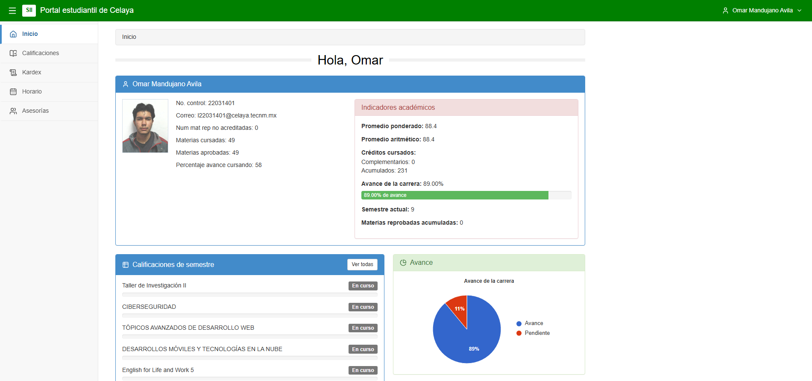
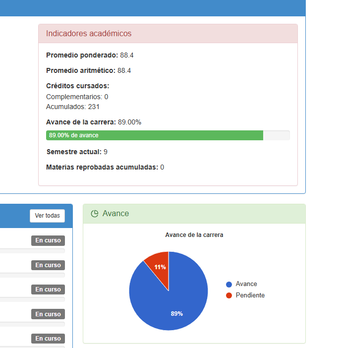
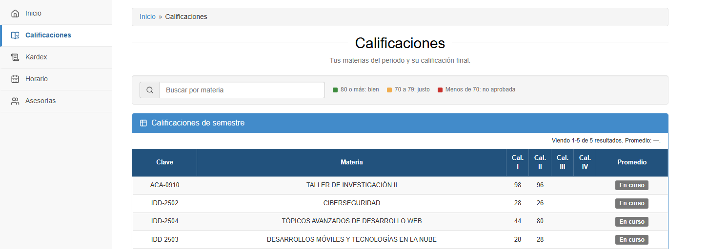
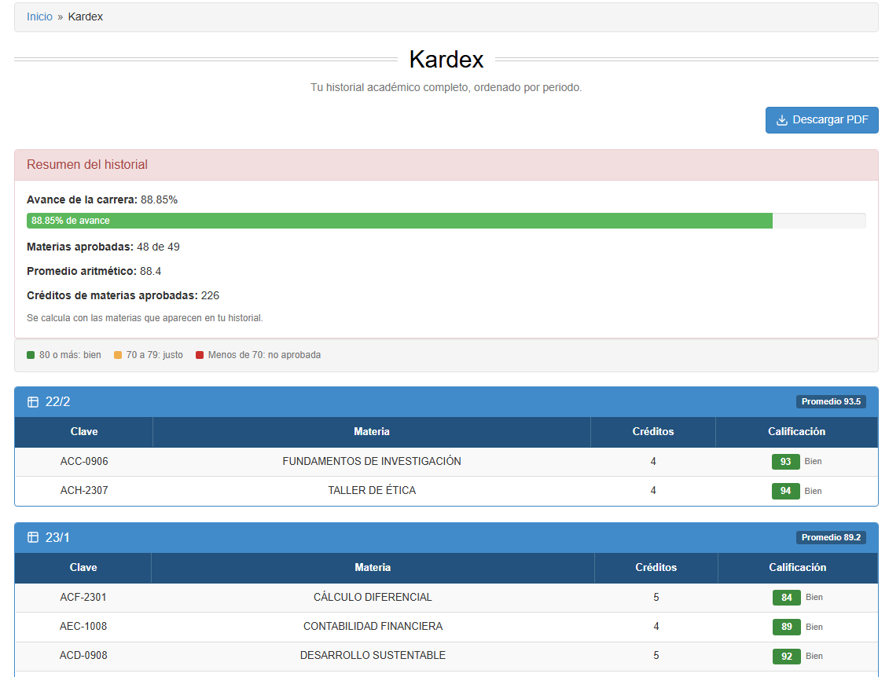
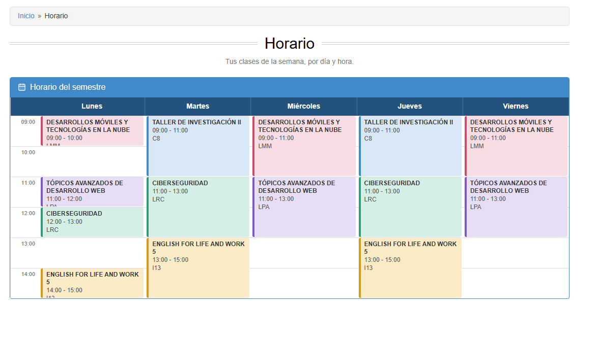
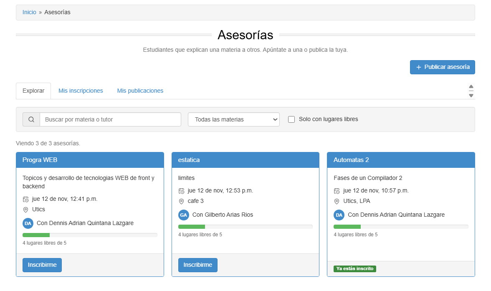
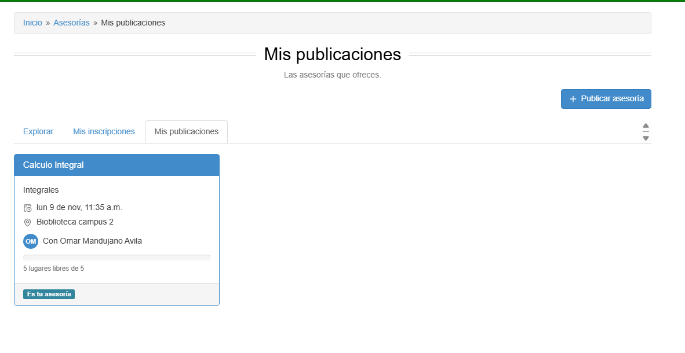
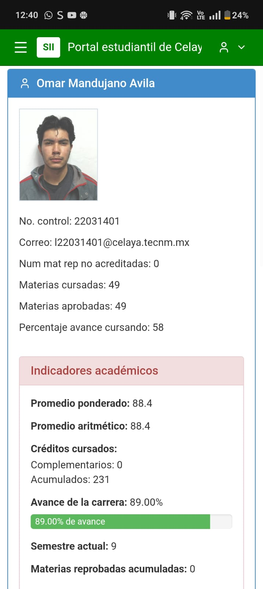

# Portal estudiantil SII — Frontend

Interfaz web del **Examen 3** (TecNM Celaya). Muestra las calificaciones, el kardex y el horario de un estudiante
y agrega una funcionalidad propuesta por el equipo: **Asesorías entre pares**.

El frontend **nunca** llama directamente a la API del SII ni a Supabase: habla solo con el backend del equipo,
que hace de intermediario.

```
Navegador ──► Frontend (React, Vercel) ──/api/*──► Backend (Node.js + Express, Render) ──► API del SII ITC
                                                                                       └─► Supabase (asesorías)
```

| | URL |
|---|---|
| Frontend (Vercel) | https://sii-frontend.vercel.app |
| Backend (Render) | https://sii-backend-web-2026.onrender.com |
| Repositorio del frontend | https://github.com/omarsyn/sii-frontend |

> El backend está en el plan gratuito de Render: si lleva un rato sin uso, la primera petición puede tardar
> de 30 a 60 segundos en responder.

## Integrantes

| Integrante | Parte |
|---|---|
| Integrante 1 — Omar Mandujano Avila | Frontend: interfaz, rutas, sesión, calificaciones, kardex (con PDF), horario y asesorías |
| Integrante 2 —Dennis Adrian Quintana Lazgare | Backend: API intermediaria, autenticación con cookie, integración con el SII y Supabase |

## Tecnología elegida: React + Vite

- **React 19**: interfaz por componentes y estado con hooks.
- **Vite**: arranque inmediato, recarga instantánea al desarrollar y build optimizado para Vercel.
- **React Router**: rutas públicas y privadas (`/login` es pública; todo lo demás está protegido).
- **jsPDF + jspdf-autotable**: generación del reporte de kardex en PDF, directo en el navegador.
- **lucide-react**: íconos. No se usa librería de UI: los estilos son propios (`src/index.css`).

**Por qué:** es una aplicación de una sola página que no necesita renderizado en servidor (todos los datos son
privados y vienen de la API), Vercel la despliega sin configuración y el trabajo se reparte fácil por rutas.

## Instalación y ejecución

Requisitos: Node.js 20 o superior.

```bash
git clone https://github.com/omarsyn/sii-frontend.git
cd sii-frontend
npm install
cp .env.example .env      # y ajusta las variables (abajo)
npm run dev               # http://localhost:5173
```

| Comando | Qué hace |
|---|---|
| `npm run dev` | Servidor de desarrollo |
| `npm run build` | Build de producción en `dist/` |
| `npm run preview` | Sirve el build localmente |

### Variables de entorno

| Variable | Descripción |
|---|---|
| `VITE_BACKEND_URL` | URL del backend, sin `/` final. **Déjala vacía en producción**: ahí `/api` se reenvía con un rewrite de Vercel. En local, por ejemplo `http://localhost:3000`. |
| `VITE_USE_MOCK` | `true` = datos de demostración sin backend (solo desarrollo). **`false` en producción.** |

Las variables `VITE_*` se incrustan al compilar: si las cambias en Vercel hay que hacer **Redeploy**.

### Modo demostración

Con `VITE_USE_MOCK=true` se puede trabajar sin backend: entra con cualquier correo y contraseña.
La contraseña `error` simula credenciales incorrectas y `caido` simula servidor no disponible.
Siempre se muestra un aviso visible para que no se confunda con datos reales.

## Despliegue en Vercel

1. Sube el repo a GitHub e impórtalo en Vercel como **New Project** (detecta Vite solo).
2. En *Settings → Environment Variables* agrega `VITE_USE_MOCK=false` (y no definas `VITE_BACKEND_URL`).
3. `vercel.json` reenvía `/api/*` al backend en Render y manda el resto de las rutas a `index.html`
   (así recargar en `/kardex` no da 404):

   ```json
   {
     "rewrites": [
       { "source": "/api/:path*", "destination": "https://sii-backend-web-2026.onrender.com/api/:path*" },
       { "source": "/(.*)", "destination": "/index.html" }
     ]
   }
   ```

4. Cada `git push` a `main` redespliega automáticamente.

**Por qué un rewrite:** para el navegador, el backend queda en el mismo dominio que el frontend. Así la cookie de
sesión es "propia" y no hay problemas de CORS ni de cookies de terceros.

## Sesión y seguridad

- Al iniciar sesión, el backend crea una cookie **`httpOnly`** (`sii_token`). El frontend no la guarda ni puede
  leerla con JavaScript: solo manda `credentials: 'include'` en cada petición.
- Las rutas privadas están protegidas: sin sesión se redirige a `/login` y, tras entrar, se vuelve a la página pedida.
- Si el servidor responde **401** (sesión vencida, a las 2 horas) se cierra la sesión y se avisa en el login.
- Al salir se llama a `POST /api/local/logout`, que es quien borra la cookie.
- En el navegador solo se guarda una marca de que hay sesión; nunca la contraseña ni el token.

## Pantallas y rutas

| Ruta | Acceso | Contenido |
|---|---|---|
| `/login` | Pública | Correo y contraseña. Valida campos vacíos y muestra el mensaje de error que manda el backend (credenciales incorrectas, servicio caído, etc.) |
| `/` | Privada | Dashboard: perfil con foto, promedio ponderado, avance de la carrera, calificaciones en barras y próximas asesorías. Con *skeleton* mientras carga |
| `/calificaciones` | Privada | Tabla (tarjetas en celular) con búsqueda en vivo por materia y **semáforo**: verde ≥ 80, amarillo 70–79, rojo < 70 |
| `/kardex` | Privada | Historial por periodo con promedio y créditos, y descarga del reporte en **PDF** |
| `/horario` | Privada | Cuadrícula semanal (escritorio) y agenda por día (celular) |
| `/asesorias` | Privada | Explorar asesorías que aún no han ocurrido, buscar, filtrar e inscribirse |
| `/asesorias/mis-inscripciones` | Privada | Asesorías a las que te inscribiste desde este navegador |
| `/asesorias/mis-publicaciones` | Privada | Asesorías que publicaste: publicar una nueva, editar o eliminar las tuyas |

Todas las pantallas manejan los tres estados: **cargando** (esqueletos), **error** (mensaje con botón *Reintentar*)
y **vacío** (explica qué hacer).

## Funcionalidad adicional: Asesorías entre pares

**Problema:** los estudiantes que dominan una materia no tienen un canal para ayudar a quienes la reprueban o la
llevan justa, y la ayuda se organiza por chats dispersos.

**Propuesta:** un tablón donde cualquier estudiante publica una asesoría (materia, tema, lugar, fecha y cupo) y otros
se inscriben.

**Cómo funciona:**

- Cualquier estudiante **publica** una asesoría; solo su autor puede **editarla o eliminarla**.
- El tablón **solo muestra asesorías que aún no han ocurrido**: al pasar su fecha y hora desaparecen del portal.
- Cada asesoría tiene **cupo**: se ve cuántos lugares quedan, y al llenarse ya no deja inscribirse. El servidor lo
  valida (responde 409), no solo la interfaz.
- Un alumno no puede inscribirse dos veces a la misma asesoría.
- Al editar no se puede bajar el cupo por debajo de los alumnos ya inscritos.
- Al eliminar una asesoría se cancelan también sus inscripciones (la pantalla avisa cuántas son).

**Beneficios:** quien necesita ayuda encuentra horarios y lugares concretos; el tutor refuerza lo que sabe; el cupo
limita los grupos para que la sesión sea útil; todo queda centralizado con la identidad del SII.

## Endpoints del backend que usa el frontend

El contrato completo está en `API_CONTRACT.md` (y en el `openapi.yaml` del backend).

| Método | Ruta | Uso |
|---|---|---|
| POST | `/api/local/login` · `/api/local/logout` | Iniciar y cerrar sesión |
| GET | `/api/local/estudiante` | Perfil, promedio y avance |
| GET | `/api/local/calificaciones` | Calificaciones por unidad |
| GET | `/api/local/kardex` | Historial académico |
| GET | `/api/local/horarios` | Horario semanal |
| GET · POST | `/api/local/asesorias` | Listar (solo futuras) y publicar |
| POST | `/api/local/asesorias/inscripcion` | Inscribirse (409 si ya está inscrito, el cupo está lleno o ya pasó) |
| PUT · DELETE | `/api/local/asesorias/:id` | Editar y eliminar (solo el tutor) |

## Estructura

```
src/
  api/          client.js (fetch con cookie de sesión y errores), real.js (backend), mock.js (demo),
                index.js (elige real o mock), asesorias.js (arma las vistas de asesorías)
  context/      AuthContext (sesión y perfil), ToastContext (avisos)
  components/   Layout, RutaPrivada, ui (Modal, Skeleton, ErrorState…)
  pages/        Login, Dashboard, Calificaciones, Kardex, Horario, asesorias/*
  utils/        normalize.js (tolera distintas formas del JSON del SII), kardexPdf.js (reporte PDF),
                format.js, session.js, inscripciones.js
```

## Diseño y responsive

La interfaz reproduce el estilo clásico del SII (barra superior verde, paneles con encabezado azul, tablas con
cabecera azul marino, recuadro rosa de *Indicadores académicos*, barras de progreso, migas de pan y títulos
centrados con doble línea). Está hecha con CSS propio. En pantallas chicas el menú lateral se vuelve un cajón con
botón de hamburguesa, la tabla de calificaciones pasa a tarjetas y el horario semanal a una lista por día.

## Limitaciones conocidas

- **Mis inscripciones** solo refleja las inscripciones hechas desde este navegador: el backend aún no ofrece un
  endpoint que diga en cuáles asesorías está inscrito cada alumno.
- El tutor no puede ver la lista de alumnos inscritos en su asesoría (el backend no la expone).
- Editar y eliminar identifican al tutor por su número de control, que viaja en la petición. Lo ideal es que el
  backend lo tome del token de sesión.
- El primer acceso tras un rato sin uso puede tardar por el plan gratuito de Render.

## Capturas de pantalla
## Capturas de pantalla

### Escritorio

| Login | Dashboard |
|---|---|
|  |  |

| Calificaciones | Kardex |
|---|---|
|  |  |

| Horario | Asesorías |
|---|---|
|  |  |

| Mis publicaciones |
|---|
|  |

### Celular

| Dashboard (móvil) |
|---|
|  |


